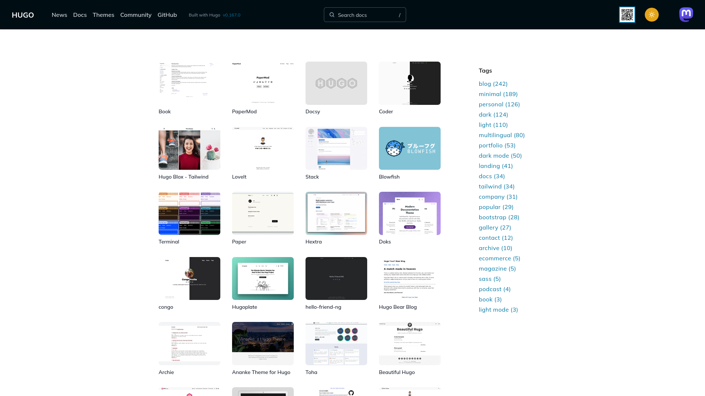
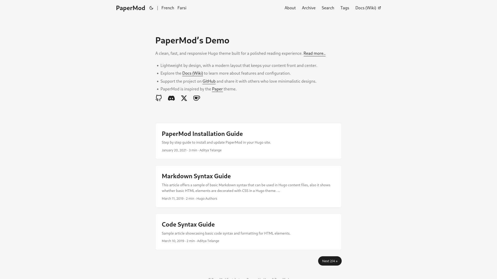
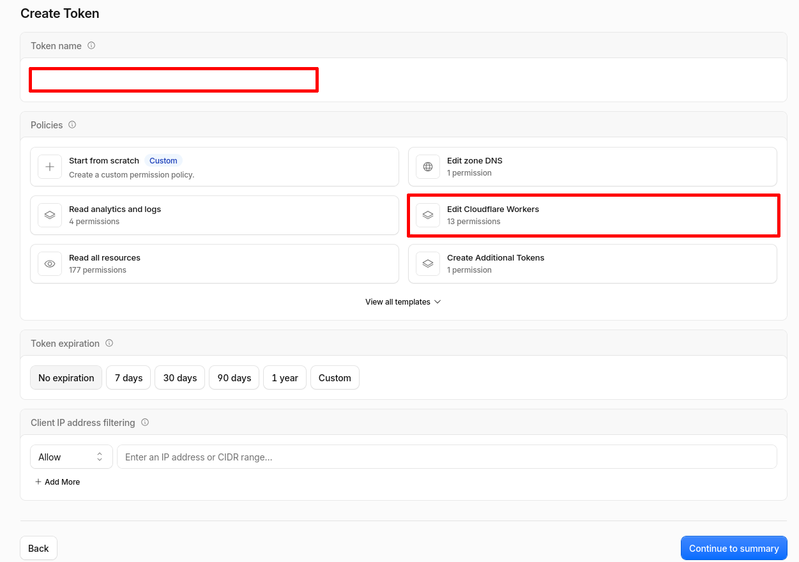
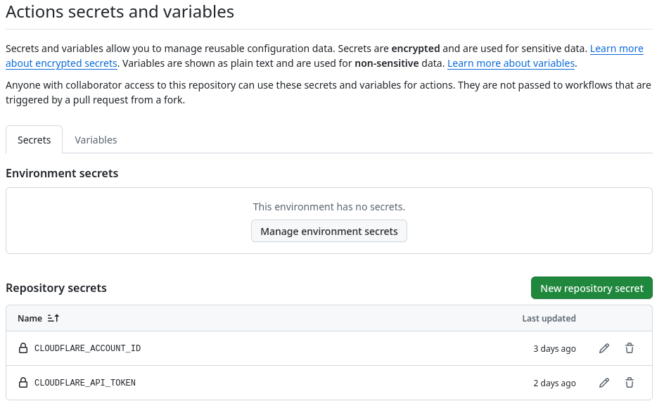
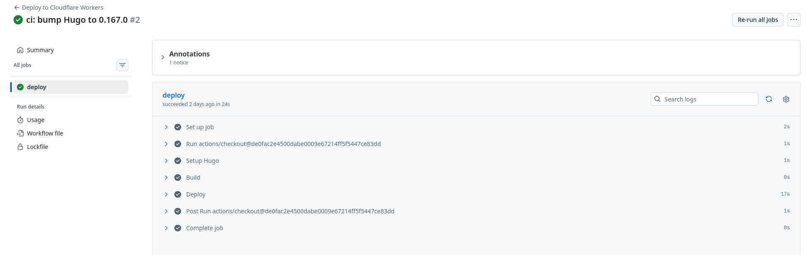
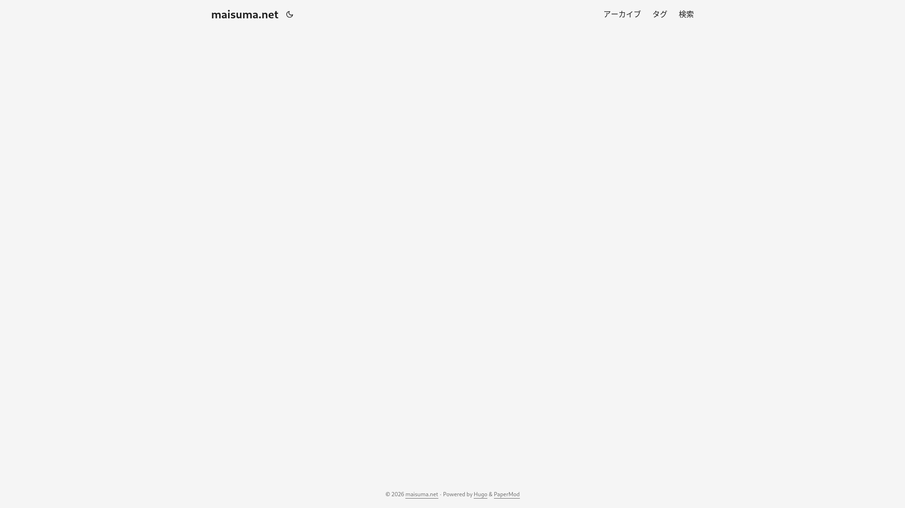

## はじめに

Hugo と Cloudflare Workers を使って静的サイトのブログを作ってみました。

## 環境

- Hugo v0.167.0
- PaperMod (commit: 118119693d8b5ac211b939775678310973bcb232)
- Cloudflare Registrar で取得したドメイン（[maisuma.net](https://maisuma.net)）

このブログのソースコードは [maisuma/blog](https://github.com/maisuma/blog) で公開しています。

## Hugo のセットアップ

### インストール

[公式ドキュメント](https://gohugo.io/installation/)を参考に、Hugo をインストールする。

### サイトの作成

サイトの作成と、`git init` を行います。

```sh
hugo new project blog --format yaml
cd blog
git init
```

> 古い記事では `hugo new site` が紹介されがちですが、Hugo v0.156.0 からは `hugo new project` がデフォルトのコマンドになっています。

### テーマの追加

[Hugo Themes](https://themes.gohugo.io/) では、さまざまなテーマが紹介されています。



今回は [PaperMod](https://github.com/adityatelange/hugo-PaperMod) テーマを使ってみます。



PaperMod の submodule を追加します。

```sh
git submodule add --depth=1 https://github.com/adityatelange/hugo-PaperMod themes/PaperMod
```

### `hugo.yaml` の設定

`hugo.yaml` では、Hugo サイトの設定を記述することが出来ます。

```yaml
baseURL: https://example.com/
locale: ja-jp
title: サイト名
theme: ["PaperMod"]
```

それぞれの項目の意味は以下の通りです。

- `baseURL`: 公開するサイトの URL。独自ドメインを使う場合はそのドメインを指定します
- `locale`: サイトの言語。日本語のサイトなので `ja-jp` を指定します
- `title`: サイトのタイトル。ヘッダーやブラウザのタブに表示されます
- `theme`: 使用するテーマ。`themes/` 以下に追加したディレクトリ名を指定します

この他にも、PaperMod 独自の設定は `params` 以下に記述出来ます。
詳しくは [PaperMod の Wiki](https://github.com/adityatelange/hugo-PaperMod/wiki/Installation) を参照してください。


### プレビューの確認

さて、ここでサイトのプレビューを確認してみましょう。

`hugo server` でサーバーを起動後、[http://localhost:1313/](http://localhost:1313/) にアクセスします。


ブログのサーバーをローカルに建てることが出来ました。記事を編集する際は、`hugo server` コマンドでプレビューを確認しながら編集します。

## Cloudflare Workers のセットアップ

ブログ公開用のプラットフォームとして、Cloudflare Workers を用います。

Cloudflare の静的サイト向けのプラットフォームとして、他にも Cloudflare Pages が挙げられます。他の解説記事では Cloudflare Pages を用いる構成も多く見受けられます。

しかし、[Workers のベストプラクティスのページ](https://developers.cloudflare.com/workers/best-practices/workers-best-practices/#use-workers-static-assets-for-new-projects)には、新しいプロジェクトでは Pages ではなく Workers を使うこと、また新機能や最適化は Workers に集中することが書かれています。

> Workers Static Assets is the recommended way to deploy static sites, single-page applications, and full-stack apps on Cloudflare. If you are starting a new project, use Workers instead of Pages. Pages continues to work, but new features and optimizations are focused on Workers.

そのため、今回は Cloudflare Workers を使って構築してみました。

### `wrangler.jsonc` の作成

Cloudflare Workers 用のデプロイ設定を記述します。

```jsonc
{
  "name": "blog",
  "compatibility_date": "2026-11-01",
  "assets": {
    "directory": "./public",
    "not_found_handling": "404-page"
  },
  "routes": [
    {
      "pattern": "example.com",
      "custom_domain": true
    }
  ]
}

```

### API トークンの作成

Cloudflare の Profile から API トークンを作成します。

Token name に適当なトークン名を入力し、Policies では Edit Cloudflare Workers を選択します。



Zone policy はブログで使うドメイン、Account policy は自分のアカウントを選択してください。

作成完了後、API トークンが表示されるのでメモしておきます。

## GitHub リポジトリのセットアップ

### リポジトリを作成する

GitHub にリポジトリを作成しておきます。

### API トークンの設定

作成したリポジトリ内に、デプロイ用の API トークンを設定します。

リポジトリで Settings → Secrets and variables → Actions を開きます。

Repository secrets に以下のシークレットを作成します。

- CLOUDFLARE_ACCOUNT_ID: Cloudflare のアカウント ID（[確認方法](https://developers.cloudflare.com/fundamentals/account/find-account-and-zone-ids/)）
- CLOUDFLARE_API_TOKEN: 先程作成した API トークン

以下のように作成されていれば問題ありません。



### workflow の設定

main ブランチへの push 時に、自動で Cloudflare Workers にデプロイされるように設定します。

プロジェクトに戻り、`.github/workflows/deploy.yaml` に以下の内容を書き込みます。（バージョンは適宜書き換えてください）

```yaml
name: Deploy to Cloudflare Workers

on:
  push:
    branches: [main]

concurrency:
  group: ${{ github.workflow }}-${{ github.ref }}
  cancel-in-progress: true

jobs:
  deploy:
    runs-on: ubuntu-latest
    permissions:
      contents: read
    steps:
      - uses: actions/checkout@de0fac2e4500dabe0009e67214ff5f5447ce83dd # v6.0.2
        with:
          submodules: true

      - name: Setup Hugo
        uses: peaceiris/actions-hugo@2752ce1d29631191ea3f27c23495fa06139a5b78 # v3.2.1
        with:
          hugo-version: '0.167.0'

      - name: Build
        run: hugo --minify

      - name: Deploy
        uses: cloudflare/wrangler-action@953926a2e2182532811c01a25e53647d93bf07c0 # v4.1.3
        with:
          apiToken: ${{ secrets.CLOUDFLARE_API_TOKEN }}
          accountId: ${{ secrets.CLOUDFLARE_ACCOUNT_ID }}
          wranglerVersion: '4.157.0'
          command: deploy
```

### `.gitignore` の設定

余計なファイル（公開用の `public` など）をコミットしないために、`.gitignore` も設定しておきます。

以下は [GitHub 公式の Hugo 向けの `.gitignore`](https://github.com/github/gitignore/blob/main/community/Golang/Hugo.gitignore) です。

```text
# Generated files by hugo
/public/
/resources/_gen/
/assets/jsconfig.json
hugo_stats.json

# Executable may be added to repository
hugo.exe
hugo.darwin
hugo.linux

# Temporary lock file while building
/.hugo_build.lock
```

## デプロイ

今回の内容をすべてコミットし、GitHub にプッシュします。



正常に CI が通り、ブログのウェブサイトにアクセス出来れば成功です。


