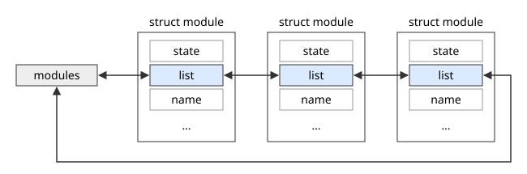
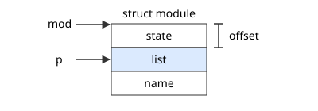

Linux カーネルにおけるリストのデータ構造である `list_head` について調べた内容の整理

## `list_head` とは？

Linux カーネルにおいて、リストは `list_head` 構造体として表現されます。

```c
// include/linux/types.h
struct list_head {
	struct list_head *next, *prev;
};
```

普通の双方向リストであることは一目瞭然だと思いますが、前後のポインタだけしか定義されておらず、中身のデータが見つかりません。

そこで、実際に使用されている箇所を探してみます。

```c
// include/linux/module.h
struct module {
	enum module_state state;

	/* Member of list of modules */
	struct list_head list;

	/* Unique handle for this module */
	char name[MODULE_NAME_LEN];
    ...
```

なんと、構造体の中に `list_head` が定義されているようです。

一般的な高級言語において、以下のようにリストがデータを保持していることは、みなさんよくご存知だと思われます。

```cpp
std::list<Module> modules;
```

一方、Linux カーネルではその逆で、データの中にリストを埋め込んでいます。

一体これはどのように使うのでしょうか？

### `list_head` の仕組み



先述した `module` 構造体は、`list_head` を経由してお互いに繋がっています。また、先頭は `kernel/module/main.c` で `modules` として定義されています。

つまり、`modules` からスタートして、各 `list_head` を辿ることで、リストの中身を走査することが出来るわけです。

しかし、これだけでは `list_head` は辿れますが、構造体の他メンバは取得できません。これでは困りました。`state` や `name` を参照することができません。

## `container_of` とは？

`container_of` は、構造体のメンバのポインタから、その構造体自身のポインタを取得するためのマクロ関数です。

例えば、以下のように `list_head` のポインタから、構造体のポインタを取得することが出来ます。

```c
struct module *mod = container_of(p, struct module, list);
```

これで、`mod->state` や `mod->name` とすることで、他のメンバを取得できるようになりました。



内部的には、`p` のアドレスから `list` メンバのオフセットを引き、`mod` のアドレスを求めています。こうすることで、構造体のメンバから、構造体自身を取得する処理を実現しています。

## 便利な関数

Linux カーネルには、リストを操作するための様々な便利な関数が用意されています。

詳細は[公式ドキュメント](https://www.kernel.org/doc/html/v7.3/core-api/list.html)にまとめられているので、ぜひ調べてみてください。

以下に一例を紹介します。

### `LIST_HEAD`

`LIST_HEAD` は空の `list_head` を作るマクロ関数です。
`next` と `prev` が自分自身を指す `list_head` を作成します。

例えば、先ほどの `modules` は以下のように定義されています。

```c
// kernel/module/main.c
LIST_HEAD(modules);
```

### `list_add`

`list_add` はリストに要素を追加する関数です。第二引数に渡された `list_head` の後ろに、新しい要素が追加されます。

```c
list_add(&mod->list, &modules);
```

### `list_for_each_entry`

`list_for_each_entry` はリストの要素を走査するマクロ関数です。

お気持ち的には、他の言語でよく出てくる `foreach` と同じ考え方です。

```c
struct module *entry;

list_for_each_entry(entry, &modules, list) {
	printk("%s\n", entry->name);
}
```

### `list_del`

`list_del` はリストから要素を削除する関数です。

```c
list_del(&mod->list);
```
